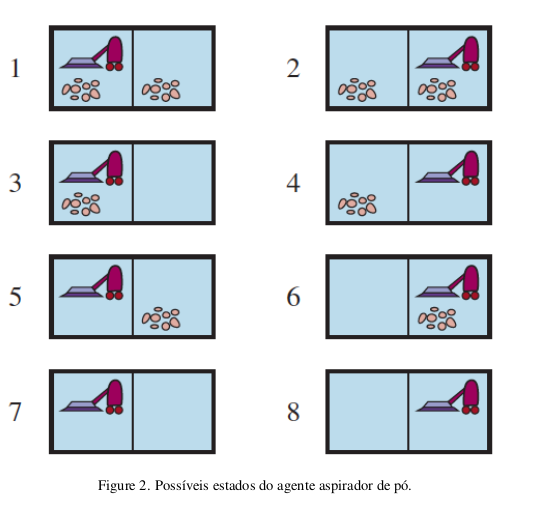
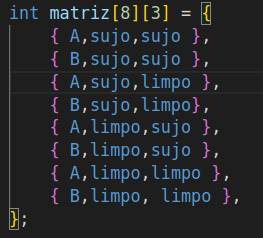
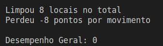

# Código de Agente Reativo simples com estado
#Robô aspirador
<h2 align="center"> Marinêz Werneck Magalhães </h2>

 

## Enunciado:

Implemente um agente reativo simples para o ambiente do aspirador.
Execute o ambiente do aspirador com este agente para todas configurações
iniciais da sujeira possíveis e locais dos agentes. Registre a pontuação
de desempenho para cada configuração e a pontuação média geral.

Considere uma versão modificada do ambiente do aspirador na Atividade 01, na qual
o agente é penalizado em um ponto para cada movimento.

- Um simples agente reativo pode ser perfeitamente racional para este ambiente? Explique.

Não, um agente reativo simples não pode ser perfeitamente racional para este ambiente, porque segue um conjunto de ações predeterminado, simplesmente reagindo ao ambiente de acordo comas entradas que recebe. Neste caso, o agente reativo simples não pode tomar decisões racionais com base no que está acontecendo no ambiente, ele só recebe a informação de que se está sujo limpe, ou se está na direita vá à esquerda, e se está na esquerda vá à direita.

- Caso sua resposta para o item anterior foi NÃO - implemente um agente reativo com estado.

  </img>

  </img>

Possíveis estados:
1) A e B = sujo, local A
2) A e B = sujo, local B
3) A = sujo e B = limpo, local A
4) A = sujo e B = limpo, local B
5) A = limpo e B = sujo, local A
6) A = limpo e B = sujo, local B
7) A e B = limpo, local A
8) A e B = limpo, local B

## Considerações:

Status = sujo 1, limpo 0;

cont_media = conta quantas vezes a limpeza foi executada;

penaliza = conta os movimentos do robô, descontando -1 a cada movimento.

  </img>

Pontuação: A cada limpeza, somar um ponto ao agente aspirador.

## Resultados:

O desempenho geral do aspirador ficou em zero, pois limpou 8 locais sujos, mas também fez 8 movimentos, perdendo 8 pontos.

  </img>

### Compilação:

| Comando  | Função                        |
| -------- | ----------------------------- |
| `make r` | Limpa tudo, compila e executa |