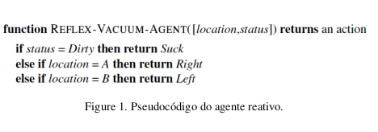

# Código de Agente Reativo simples
#Robô aspirador
<h2 align="center"> Marinêz Werneck Magalhães </h2>

 

## Enunciado:

Implemente um agente reativo simples para o ambiente do aspirador.
Execute o ambiente do aspirador com este agente para todas configurações
iniciais da sujeira possíveis e locais dos agentes. Registre a pontuação
de desempenho para cada configuração e a pontuação média geral.

  </img>

  </img>

## Possíveis estados:
- A e B = sujo, local A
- A e B = sujo, local B
- A = sujo e B = limpo, local A
- A = sujo e B = limpo, local B
- A = limpo e B = sujo, local A
- A = limpo e B = sujo, local B
- A e B = limpo, local A
- A e B = limpo, local B

## Considerações:

Status = sujo 1, limpo 0;

local = 0 sem aspirador, 1 com aspirador;

cont_media = conta quantas vezes a limpeza foi executada;

Pontuação: A cada limpeza, somar um ponto ao agente aspirador.

Pontuação Final: Soma de 16 estados possíveis / 16.

Desempenho satisfatório >= 0.3

## Resultado obtido:

Desempenho: 0.5 ou 50%, considerado satisfatório pelos parâmetros estabelecidos.

### Compilação:

| Comando | Função |
|---------| --------|
| `make r` | Limpa tudo, compila e executa |
